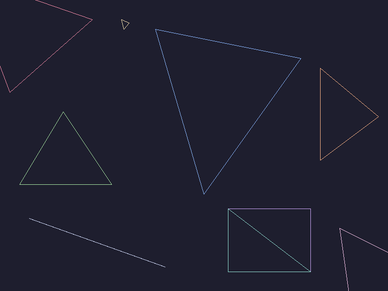
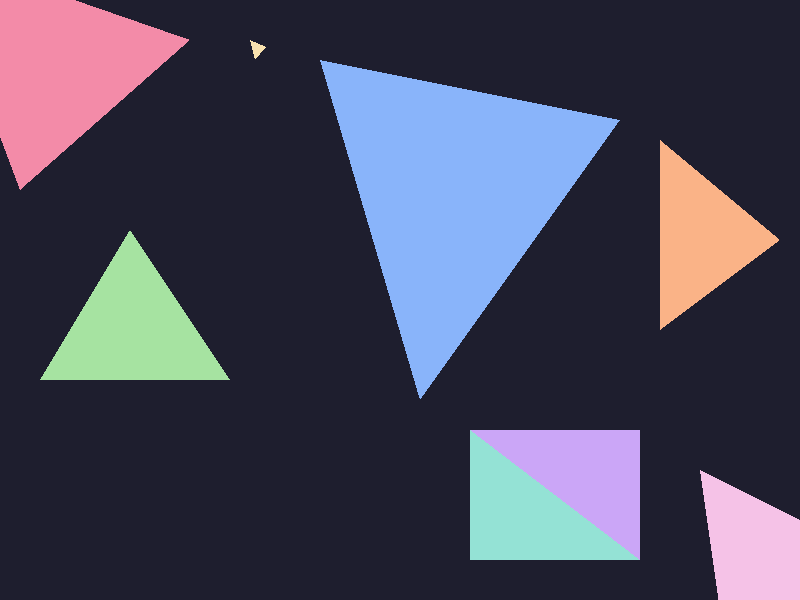
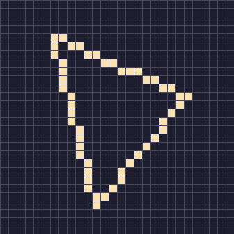
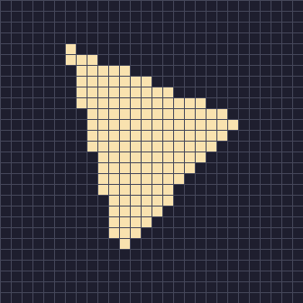
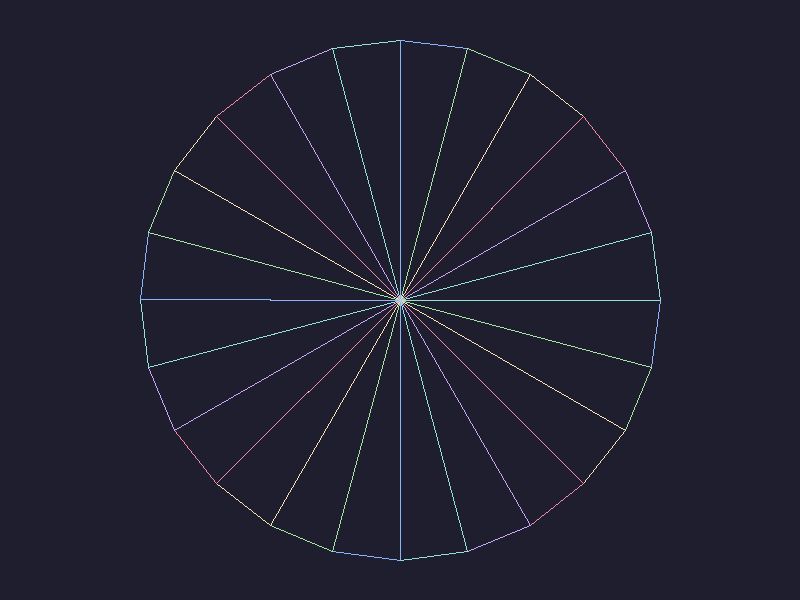
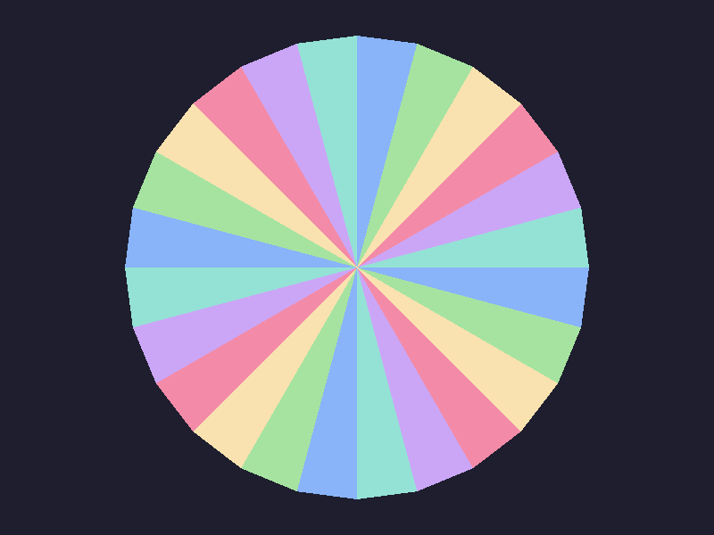
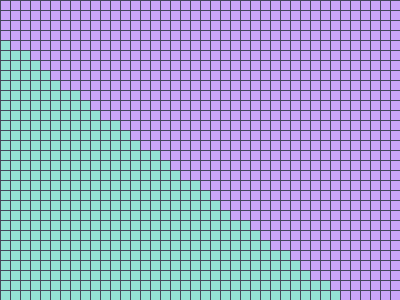
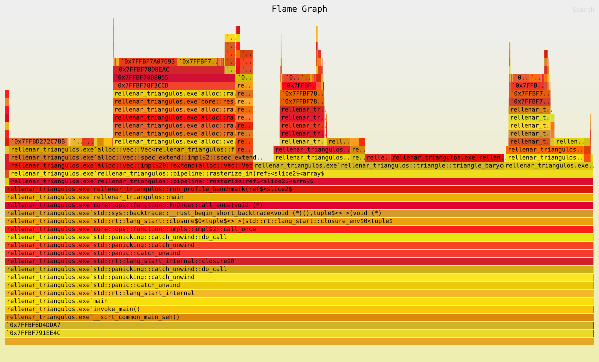

# Laboratorio 5 – Rellenar triángulos

Antes, mi función `triangle` solo dibujaba los tres bordes del triángulo. En este lab
le agregué dos formas de rellenarlo:

1. **Coordenadas baricéntricas**: recorro la caja que encierra al triángulo y pruebo cada píxel.
2. **Líneas horizontales (scanline)**: recorro fila por fila y pinto el tramo que queda adentro.

Después revisé que los dos generaran **exactamente las mismas posiciones**, medí cuánto
tarda cada uno y usé `cargo flamegraph` para ver en qué se va el tiempo. Todo está en Rust con raylib.

---

## Cómo correrlo

Se necesita Rust (stable) y, por raylib, **CMake** y un compilador de C (en Windows, las
Build Tools de Visual Studio). La primera compilación tarda un poco porque compila raylib.

```bash
git clone https://github.com/Gotkissss/Laboratorio5-Gr-ficas
cd Laboratorio5-Gr-ficas
cargo run --release
```

### Controles de la ventana

| Tecla | Qué hace |
|---|---|
| `1` / `2` / `3` | Wireframe / relleno baricéntrico / relleno scanline |
| `←` / `→` | Cambiar de escena (vitrina, cada caso de prueba, abanico, aleatorios) |
| `Z` | Lupa que sigue al mouse (aumenta 8x para ver los bordes píxel por píxel) |
| `H` | Mostrar u ocultar la ayuda |

Abajo, el HUD muestra el modo, cuántos fragmentos salieron y cuánto tardó **solo** la
rasterización de ese cuadro.

### Otros modos (sin ventana)

| Comando | Qué hace |
|---|---|
| `cargo test --release` | Corre todas las pruebas (unitarias y de comparación) |
| `cargo run --release -- --compare` | Compara las posiciones de los dos rellenos en cada caso de prueba |
| `cargo run --release -- --measure` | Mide los tiempos (mediana) y guarda la tabla en `resultados/mediciones.md` |
| `cargo run --release -- --screenshots` | Genera las imágenes de `capturas/` |
| `cargo run --release -- --benchmark-triangles` | Rasteriza muchas veces y termina, para el perfilador |

El modo para el perfilador acepta `--mode bari|scan|wire|all` y `--iterations N`.

```bash
cargo install flamegraph
cargo flamegraph -- --benchmark-triangles
```

> En Windows, `cargo flamegraph` usa ETW y **tiene que correrse en una terminal como
> administrador**; si no, da el error `NotAnAdmin`. En Linux usa `perf`.

---

## Modos de dibujo

```rust
#[derive(Clone, Copy, Debug, PartialEq, Eq)]
pub enum TriangleMode {
    Wireframe,
    FilledBarycentric,
    FilledScanline,
}
```

`rasterize(&triangles, mode)` es lo único que cambia entre modos. El ensamblaje de
primitivas (`primitive_assembly`, que agrupa los vértices de 3 en 3) y el procesamiento de
fragmentos (`process_fragments`, que escribe en el framebuffer) son los mismos para los tres.

- `Wireframe` → `triangle_wireframe`: las tres llamadas a `line` (Bresenham) de antes.
- `FilledBarycentric` → `triangle_barycentric(v1, v2, v3, ...) -> Vec<Fragment>`
- `FilledScanline` → `triangle_scanline(v1, v2, v3, ...) -> Vec<Fragment>`

## Imágenes de cada modo

La escena "vitrina" tiene un ejemplo de cada caso: uno pequeño (amarillo), uno grande
(azul), uno con borde horizontal (verde), uno con borde vertical y vértices en orden horario
(naranja), dos que comparten una diagonal (morado/turquesa), tres puntos alineados (solo se ve
en wireframe) y dos que se salen de la imagen (esquinas).

| Wireframe | Baricéntrico | Scanline |
|---|---|---|
|  |  |  |
|  |  |  |
|  |  |  |

La segunda fila es un acercamiento 12x al triángulo pequeño. La tercera es un abanico de 24
triángulos que comparten aristas. Acercamiento a la diagonal compartida (sin huecos ni encimados):

| Baricéntrico | Scanline |
|---|---|
|  |  |

Las imágenes del baricéntrico y del scanline salen **idénticas byte por byte** (lo revisé con `cmp`).

---

## Algoritmo 1: coordenadas baricéntricas

1. Calculo el área con signo usando la "función de arista"
   `E(a, b, p) = (b.x - a.x)(p.y - a.y) - (b.y - a.y)(p.x - a.x)`.
2. Si el área es **0** los tres puntos están alineados: es un caso degenerado y regreso
   un `Vec` vacío (así nunca divido entre cero).
3. Si el área es negativa (vértices en el otro orden) intercambio dos vértices. Así el
   triángulo **no desaparece al invertir el orden** y las aristas siempre tienen la misma dirección.
4. Recorro la caja envolvente (recortada al framebuffer) y evalúo el centro de cada
   píxel `(x + 0.5, y + 0.5)`.
5. Las coordenadas baricéntricas son `w1 = E(b,c,p)/área`, `w2 = E(c,a,p)/área`,
   `w3 = E(a,b,p)/área`. Si las tres indican que está adentro, genero el fragmento con un
   color uniforme (el del primer vértice).

## Algoritmo 2: líneas horizontales

1. Mismo chequeo de área 0.
2. Ordeno los vértices por `y` (`top`, `mid`, `bottom`).
3. Para cada fila cuyo centro `yc` cumple `top.y <= yc < bottom.y`, calculo dónde la cruza
   la arista larga (`top → bottom`) y una de las cortas (`top → mid` si `yc < mid.y`, si no
   `mid → bottom`).
4. Genero los píxeles cuyo centro cumple `x_izq <= xc < x_der`.

## La regla de los bordes (y lo que encontré al comparar)

Lo difícil es decidir qué pasa cuando el centro de un píxel cae **justo sobre una arista**.
Si no hay una regla consistente, dos triángulos vecinos pintan ese píxel dos veces (o ninguno).

**El scanline** usa intervalos medio abiertos:
- Filas: `y_arriba <= yc < y_abajo`. Un vértice que cae justo en una fila cuenta para la
  arista que *empieza* ahí y no para la que *termina*, y las aristas horizontales nunca se
  usan para intersecar (su rango está vacío).
- Columnas: `x_izq <= xc < x_der`. El borde izquierdo entra y el derecho no.

**Mi primera versión del baricéntrico** usaba `w >= 0` en las tres coordenadas, es decir,
incluía todo centro que cayera sobre cualquier arista. Con `--compare` salió esto
(commit `d86beca`):

| Caso | bari | scan | solo en bari | repetidos en bari |
|---|---:|---:|---:|---:|
| 1a. Pequeño | 40 | 34 | 6 | 0 |
| 4. Parcialmente fuera | 187726 | 187719 | 7 | 0 |
| Vértices en centros de píxel | 81003 | 80000 | 802 | 201 |
| Abanico (aristas compartidas) | 210136 | 209952 | 0 | 184 |

Por ejemplo, en el triángulo pequeño la arista de (108,104) a (102,110) es la recta
`x + y = 212`, y el centro (102.5, 109.5) cae exacto sobre ella. El baricéntrico lo pintaba y el
scanline no (porque es su borde derecho). En los casos con aristas compartidas, el baricéntrico
pintaba esos píxeles **en los dos triángulos**.

**La solución fue la regla top-left** (la misma que usan las GPU) en el baricéntrico. Con el
área ya normalizada a positiva y `y` creciendo hacia abajo, una arista `a → b` es:
- *top* si es horizontal y el triángulo queda debajo (`a.y == b.y && b.x > a.x`),
- *left* si el triángulo queda a su derecha (`b.y < a.y`).

Un centro con `w == 0` solo cuenta si esa arista es top o left. Eso es justo lo mismo que
`y_arriba <= yc < y_abajo` y `x_izq <= xc < x_der` del scanline: se incluye el borde de arriba
y el izquierdo y se excluyen el de abajo y el derecho. Revisé también las esquinas (vértices
donde dos aristas valen 0) y coinciden en todos los casos.

### Resultado actual de `--compare`

```
caso                                        bari    scan  solo B  solo S  rep B  rep S  inverso
1a. Pequeno                                   34      34       0       0      0      0    igual
1b. Grande                                180600  180600       0       0      0      0    igual
2a. Borde horizontal                       56000   56000       0       0      0      0    igual
2b. Borde vertical                         77000   77000       0       0      0      0    igual
3. Orden inverso (1b al reves)            180600  180600       0       0      0      0    igual
4. Parcialmente fuera                     187719  187719       0       0      0      0    igual
5. Colineales                                  0       0       0       0      0      0    igual
Extra: arista compartida                  120000  120000       0       0      0      0    igual
Extra: vertices en centros de pixel        80000   80000       0       0      0      0    igual
Extra: coordenadas con decimales          101094  101094       0       0      0      0    igual
Extra: abanico (aristas compartidas)      209952  209952       0       0      0      0    igual
Extra: 336 triangulos aleatorios           35632   35632       0       0      0      0    igual

Ambos algoritmos generan exactamente las mismas posiciones en todos los casos.
```

- **solo B / solo S**: posiciones que genera un algoritmo y el otro no.
- **rep**: posiciones repetidas dentro de la misma escena (en estas escenas los triángulos no
  se enciman, así que un repetido sería un error).
- **inverso**: si rasterizar los vértices al revés da las mismas posiciones.

Además, en `tests/comparacion.rs` hay pruebas que:
- comparan uno por uno **5000 triángulos con coordenadas decimales al azar**,
- arman **100 mallas** (rectángulos partidos en 1200 triángulos con los vértices interiores
  movidos al azar) y verifican que cada píxel del rectángulo salga **exactamente una vez** en
  los dos algoritmos,
- revisan que los colineales y los triángulos fuera de la imagen no generen nada.

> Sobre la precisión: hago las cuentas en `f64`. Pensé en "ajustar" los vértices a una
> cuadrícula de 1/256 de píxel como hacen las GPU, para que las funciones de arista fueran
> exactas siempre. Hice una prueba aparte con 399 mallas (unos 960 mil triángulos) y no salió
> ni un hueco ni un repetido, así que no lo agregué, pero sería lo siguiente si aparecieran
> diferencias con coordenadas más raras.

---

## Mediciones

Todo en `cargo run --release -- --measure`. Solo se mide `rasterize` (sin textura, sin
ventana, sin esperas). Cada conjunto se rasteriza N veces seguidas, eso se repite 11 veces
(más 1 de calentamiento que no cuenta) y reporto la **mediana**. Uso `black_box` para que el
compilador no se salte trabajo. También anoto los fragmentos para asegurar que los dos hacen
el mismo trabajo.

Tablas completas: [`resultados/mediciones_v1.md`](resultados/mediciones_v1.md) (primera
versión) y [`resultados/mediciones_v2.md`](resultados/mediciones_v2.md) (después de la
optimización). Tiempo por **una** rasterización:

| Conjunto | Fragmentos | Bari v1 | Scan v1 | Bari v2 | Scan v2 |
|---|---:|---:|---:|---:|---:|
| Todos los casos de prueba (373 triángulos) | 1 228 631 | 23.21 ms | 13.62 ms | 14.36 ms | 4.75 ms |
| 1b. Un triángulo grande | 180 600 | 2.92 ms | 1.72 ms | 1.85 ms | 0.88 ms |
| 1a. Un triángulo pequeño | 34 | 0.640 µs | 0.424 µs | 0.450 µs | 0.151 µs |
| 336 triángulos aleatorios pequeños | 35 632 | 860 µs | 296 µs | 711 µs | 145 µs |

Las mediciones son de mi laptop con Windows 11; los números cambian entre corridas (por
ejemplo, el triángulo grande con scanline v2 varió entre 0.70 y 1.14 ms), por eso uso la mediana.

**¿Por qué el scanline es más rápido?**
- El baricéntrico prueba **todos** los píxeles de la caja envolvente, y un triángulo ocupa
  como mucho la mitad de su caja. En los triángulos aleatorios (flacos y chuecos) la caja
  tiene mucho espacio vacío, por eso ahí la diferencia es más grande (~5x en v2).
- Por cada píxel, el baricéntrico calcula 3 funciones de arista (multiplicaciones) y 3
  divisiones. El scanline hace las cuentas **una vez por fila** y luego solo genera los
  fragmentos del tramo.
- En el triángulo grande la diferencia es menor (~2x) porque ahí casi todo el tiempo se va
  en generar y guardar fragmentos, que es igual para los dos.

## Perfil con `cargo flamegraph`

Los archivos están en [`perfil/v1/`](perfil/v1/). GitHub los muestra como imagen fija; para
usar la búsqueda y hacer clic para acercar hay que descargarlos y abrirlos en el navegador.

- [`flamegraph.svg`](perfil/v1/flamegraph.svg): los dos rellenos en la misma corrida
- [`flamegraph_baricentrico.svg`](perfil/v1/flamegraph_baricentrico.svg)
- [`flamegraph_scanline.svg`](perfil/v1/flamegraph_scanline.svg)



Los bloques que solo dicen una dirección (`0x7FFB...`) son funciones de las DLL de Windows,
que no traen símbolos. Aparecen justo encima de `alloc::vec::...`, o sea que son el
administrador de memoria del sistema pidiendo y copiando memoria cuando el `Vec` crece.

Lo que vi (porcentaje de muestras en que aparece cada función; recordar que el ancho es la
proporción de muestras, **no** el orden en que se ejecutan):

| Función | Baricéntrico | Scanline |
|---|---:|---:|
| `rasterize_in` (todo) | 98.6 % | 97.6 % |
| `triangle_barycentric` / `triangle_scanline` | 66.9 % | 42.2 % |
| ↳ `inside` (regla top-left) | 29.7 % | – |
| ↳ `Vec::push` (incluye crecer el Vec) | 20.4 % | 37.0 % |
| `Vec::extend` (copiar al Vec total) | 31.6 % | 55.5 % |
| `RawVec::reserve` / `grow_amortized` | 15.5 % | 27.9 % |

Entonces, respondiendo a la pregunta del lab:
- En el **baricéntrico** el mayor bloque son los **cálculos geométricos** (las funciones de
  arista y la prueba `inside`), pero el `Vec` se lleva casi otro tercio.
- En el **scanline** la geometría es poca, y **más de la mitad del tiempo era el `Vec`**: cada
  triángulo creaba su propio `Vec` que iba creciendo con `push`, y después `rasterize` lo
  copiaba completo con `extend` al `Vec` total (que también crecía).

### La optimización

Con eso, dejé las funciones `triangle_*` igual (siguen devolviendo `Vec<Fragment>`) pero
agregué versiones `triangle_*_into(..., out: &mut Vec<Fragment>)` que escriben directo en el
`Vec` de salida. `rasterize_in` usa esas versiones y reserva la capacidad **una sola vez** con
una estimación (la mitad del área de la caja de cada triángulo). Los fragmentos son
exactamente los mismos (las pruebas y `--compare` siguen pasando) y:

- scanline: **13.62 ms → 4.75 ms** (≈ 2.9x más rápido)
- baricéntrico: **23.21 ms → 14.36 ms** (≈ 1.6x)
- wireframe también mejoró (1.25 ms → 0.46 ms) porque ya no hace `retain` sobre un Vec aparte.

Al baricéntrico le ayudó menos porque su costo principal sí es la geometría. Para mejorarlo
habría que calcular las funciones de arista de forma incremental (sumando una constante al
avanzar un píxel en lugar de multiplicar) o saltarse los píxeles vacíos de la caja.

Para volver a generar el perfil de la versión optimizada (como administrador en Windows):

```bash
cargo flamegraph -o perfil/v2/flamegraph.svg -- --benchmark-triangles
```

---

## Conclusiones

- Los dos algoritmos generan **las mismas posiciones** si usan la misma regla para los centros
  que caen sobre una arista. Con `>= 0` el baricéntrico pintaba de más y repetía píxeles en
  aristas compartidas; con la regla top-left coincide exactamente con el scanline.
- Invertir el orden de los vértices no cambia nada y los colineales no generan fragmentos.
- El **scanline es más rápido** en todos los casos (2x a 5x en la versión final), sobre todo con
  triángulos flacos donde la caja envolvente desperdicia mucho.
- Medir solo dice *cuánto* tarda; el flamegraph me dijo *dónde*, y resultó que el `Vec`
  pesaba más que la geometría en el scanline. Sin el perfil hubiera intentado optimizar las
  cuentas, que no era lo importante.

## Estructura

```
src/
├── main.rs         ventana (raylib) y los modos --compare, --measure, --screenshots, --benchmark-triangles
├── lib.rs
├── color.rs        color RGB
├── framebuffer.rs  buffer de colores (800x600)
├── vertex.rs       Vec2 y Vertex
├── fragment.rs     Fragment (x, y, color)
├── line.rs         Bresenham
├── triangle.rs     TriangleMode, wireframe, baricéntrico y scanline
├── pipeline.rs     primitive_assembly, rasterize, process_fragments
├── scenes.rs       vitrina, casos de prueba, abanico y triángulos aleatorios
├── compare.rs      comparación de posiciones entre los dos rellenos
└── benchmark.rs    medición con mediana
tests/comparacion.rs  pruebas de que ambos rellenos coinciden
capturas/             imágenes de cada modo
resultados/           tablas de tiempos (v1 y v2)
perfil/v1/            flamegraphs
```
